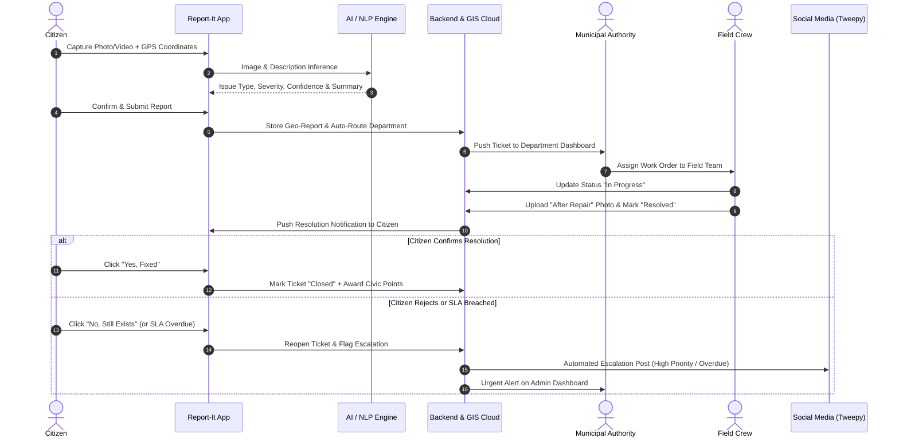

# 📱 Report-It — AI-Powered Multilingual Civic Issue Reporting & Predictive Geospatial Intelligence Platform

> **"Report. Resolve. Transform."**  
> *A closed-loop civic intelligence ecosystem connecting citizens, AI triage, municipal authorities, and predictive infrastructure analytics.*

---

[](#-tech-stack--architecture)
[](#-tech-stack--architecture)
[](#-tech-stack--architecture)
[](#-ai--machine-learning-pipeline)
[](#-multilingual-support-indictrans2)
[](#-license)

---

## 📑 Table of Contents
1. [🌟 Executive Summary](#-executive-summary)
2. [🎯 Problem Statement & "Why We Do It"](#-problem-statement--why-we-do-it)
3. [✨ Key Differentiator](#-the-key-differentiator)
4. [🧩 System Architecture & Dual Experience](#-system-architecture--dual-experience)
   - [👤 1. Citizen Mobile Experience](#-1-citizen-mobile-experience)
   - [🏛️ 2. Authority & Municipal Admin Dashboard](#-2-authority--municipal-admin-dashboard)
5. [🔄 End-to-End System Workflow](#-end-to-end-system-workflow)
6. [🤖 AI, ML & Geospatial Pipeline](#-ai-ml--geospatial-pipeline)
7. [🗺️ App Navigation Architecture](#-app-navigation-architecture)
8. [📊 Implementation Status: Phase 1 vs Future Scope](#-implementation-status-phase-1-vs-future-scope)
9. [🛠️ Tech Stack & Dependencies](#-tech-stack--dependencies)
10. [🚀 Getting Started & Installation](#-getting-started--installation)
11. [📂 Repository Structure](#-repository-structure)
12. [🔒 Privacy, Security & Moderation](#-privacy-security--moderation)
13. [👥 Contributors & Acknowledgements](#-contributors--acknowledgements)
14. [📄 License](#-license)

---

## 🌟 Executive Summary

**Report-It** is an enterprise-grade civic grievance redressal and spatial intelligence platform. Going far beyond traditional complaint-submission apps, Report-It operates as a **complete citizen → AI classification → departmental routing → field resolution → citizen verification → public monitoring loop**.

Citizens can instantly report local infrastructure decay—such as **potholes, illegal garbage dumping, water drainage bottlenecks, faulty streetlights, and pipeline leakages**—by capturing geo-tagged photographs or videos. 

The platform leverages **Computer Vision (EfficientNet-B0)** and **NLP Fallback Chains** to automatically categorize reports, calculate severity scores, filter out duplicates, generate structured summaries, and auto-route tickets to the appropriate municipal department (e.g., BBMP Engineering, Solid Waste Management, Stormwater Drainage). The entire issue lifecycle is monitored through GIS heatmaps, satellite analytics (Google Earth Engine), and automated social-media accountability workflows.

---

## 🎯 Problem Statement & "Why We Do It"

Traditional civic management systems face severe structural challenges:

| Traditional Grievance Systems | The Report-It Solution |
| :--- | :--- |
| **Manual sorting bottlenecks:** Grievances sit in queues awaiting human classification and department assignment. | **Instant AI Triage:** Automatic classification, severity estimation, and departmental routing in milliseconds. |
| **Language barriers:** Portals predominantly support English or single state languages, alienating diverse communities. | **Native Multilingual UI & NLP:** Powered by IndicTrans2 supporting 8+ regional Indian languages. |
| **Duplicate & spam floods:** Multiple citizens report the same issue, overwhelming municipal backlogs. | **Geospatial & Visual Deduplication:** Proximity clustering and AI confidence scoring eliminate redundant tickets. |
| **Premature ticket closure:** Authorities mark issues "Resolved" without on-ground citizen confirmation. | **2-Way Verification Loop:** Tickets require citizen confirmation ("Yes, Fixed" vs. "No, Reopen"). |
| **Reactive governance:** Cities repair damage only after accidents occur or complaints peak. | **Predictive Hotspot Analytics:** GIS heatmaps and satellite insights (GEE) predict failures before escalation. |
| **Zero public accountability:** Long-standing complaints get quietly ignored or lost in bureaucracy. | **Automated SLA Escalation:** Breached SLAs trigger automated public visibility (Tweepy/X) and admin alerts. |

---

## ✨ The Key Differentiator

> **Report-It is not just "an app where citizens report potholes."**  
> It is an **AI-powered civic intelligence platform** that converts citizen reports into geographically-aware, automatically classified and routed tasks, tracks their resolution, verifies outcomes with citizens, and uses aggregated spatial data to help authorities identify and prevent recurring infrastructure problems.

---

## 🧩 System Architecture & Dual Experience

The platform is designed around two tailored user experiences:

```
                  ┌──────────────────────────────────────────────────┐
                  │                 REPORT-IT PLATFORM               │
                  └────────┬────────────────────────────────┬────────┘
                           │                                │
            ┌──────────────▼──────────────┐  ┌──────────────▼──────────────┐
            │      👤 CITIZEN APP         │  │   🏛️ AUTHORITY DASHBOARD    │
            │  (Mobile - Android/Flutter) │  │       (Web & Admin App)     │
            └──────────────┬──────────────┘  └──────────────┬──────────────┘
                           │                                │
            • Geo-tagged Photo/Video Capture • Live Departmental Triage
            • IndicTrans2 Multilingual UI    • AI Confidence & Verification
            • Automated AI Severity Analysis • Field Crew Assignment & SLA
            • Real-Time Lifecycle Tracking   • Before/After Photo Validation
            • Community Map & Heatmaps       • Google Earth Engine Analytics
            • 2-Way Closure Verification     • Automated Social Escalation
```

---

### 👤 1. Citizen Mobile Experience

#### 1. Splash & Multilingual Onboarding
- Clean, modern city visual and identity.
- **Multilingual Support (IndicTrans2)**: Onboarding language selection supporting:
  - 🇬🇧 English | 🇮🇳 Kannada (ಕನ್ನಡ) | Hindi (हिन्दी) | Tamil (தமிழ்) | Telugu (తెలుగు) | Malayalam (മലയാളം) | Marathi (मराठी) | Bengali (বাংলা)
- Dynamic UI localization across navigation, labels, complaint forms, AI summaries, and push alerts.

#### 2. Authentication & Profile
- Multi-factor authentication via Firebase Authentication (Mobile Number + OTP, Email/Password, Google Sign-In).
- User profile with privacy controls and **Citizen Civic Score**.

#### 3. Home / Citizen Dashboard
- **🚨 Report an Issue**: Prominent floating action button for 1-click submission.
- **Quick Category Tiles**: Potholes 🛣️, Garbage 🗑️, Drainage 💧, Streetlights 💡, Water Leaks 🚰, Traffic Obstructions 🚦, Public Infrastructure 🌳.
- **Nearby Issues**: Radius-based feed of community complaints.
- **My Recent Reports**: Instant status chips on active submissions.
- **Civic Impact Card**: Real-time counter of total reported, resolved, and active contributions.

#### 4. 📸 Smart Geo-Tagged Reporting Flow
- **Capture**: High-resolution image/video capture with camera or gallery upload.
- **Location Engine**: Auto-locks GPS coordinates, street address, pincode, and locality, with an optional interactive map pin adjustment.

#### 5. 🤖 AI Vision & Severity Analysis
- Visual inference powered by **EfficientNet-B0**:
  - **Issue Type Detection**: (e.g., *Road Pothole, Open Drain, Garbage Dump*).
  - **AI Confidence Score**: (e.g., *94% Confidence*).
  - **Severity Calculation**: Low, Medium, High, or Critical based on estimated affected area and traffic hazard.
- User verification screen to confirm or adjust AI findings before submission.

#### 6. 🧠 AI Complaint Summarisation
- Converts raw citizen notes into standardized, actionable municipal briefs using an **NLP Fallback Chain**.
- *Example:* "Large pothole approximately 2m wide near Mysore Road junction causing severe two-wheeler hazards."

#### 7. 🏛️ Departmental Auto-Routing & Receipt
- Automatic classification maps issues to municipal bodies:
  - *Pothole* ➔ **BBMP Road Maintenance Department**
  - *Garbage Dump* ➔ **Solid Waste Management**
  - *Broken Pipe* ➔ **Bangalore Water Supply & Sewerage Board (BWSSB)**
- Instant digital receipt with a unique Tracking ID (e.g., `RI-2026-004821`).

#### 8. 📋 Lifecycle Tracking & 2-Way Resolution Verification
- 7-Stage Live Status Pipeline:
  $$\text{Submitted} \xrightarrow{} \text{AI Analyzed} \xrightarrow{} \text{Verified} \xrightarrow{} \text{Assigned} \xrightarrow{} \text{In Progress} \xrightarrow{} \text{Resolved} \xrightarrow{} \text{Citizen Closed}$$
- **Anti-Fraud Verification**: When authorities mark an issue "Resolved", the citizen is prompted:
  - `[Yes, Fixed]` ➔ Ticket moves to **Closed**; Citizen Score increases.
  - `[No, Still Exists]` ➔ Ticket auto-reopens and escalates with penalty flags.

#### 9. 🗺️ Community Map & Heatmap
- Interactive Map showing colored status pins for all public civic issues.
- Heatmap overlay mode highlighting high-density problem clusters (🟢 Low, 🟡 Moderate, 🔴 High).

#### 10. 🏆 Civic Gamification & Community Validation
- **Civic Score**: Points awarded for verified reports, accurate tags, and closure validations.
- **Badges**: *Active Citizen*, *Civic Champion*, *Neighborhood Guardian*.
- **"👍 Confirm Issue"**: Community upvoting to validate existing reports and prevent duplicates.

#### 11. 📢 Automated Social Media Visibility (Escalation)
- High-severity or overdue issues exceeding municipal SLA automatically trigger public posts via **Tweepy (X/Twitter)** with privacy safeguards.

---

### 🏛️ 2. Authority & Municipal Admin Dashboard

#### 1. Command Center & KPI Metrics
- Real-time counters: *Total Reports, Pending Triage, High-Priority, In-Progress, Overdue (SLA Breached), Average Resolution Time (e.g., 2.3 Days)*.

#### 2. 📥 Complaint Management & AI Verification Panel
- Comprehensive triage table with filtering by Ward, Department, Severity, and AI Confidence.
- Officer review suite: Accept AI classification, correct tags, mark duplicates, or re-route.

#### 3. 👷 Crew Dispatch & Work Management
- Direct assignment to field engineers or zonal teams.
- Field crew app integration: Status updates from *Assigned* ➔ *Accepted* ➔ *In Progress* ➔ *Resolved*.
- Mandatory upload of **Before vs. After completion evidence photos**.

#### 4. 🛰️ Geospatial & Satellite Analytics (GEE)
- Hotspot density analysis pinpointing chronically failing roads or repeat drainage choke points.
- **Google Earth Engine Integration**: Satellite layer comparisons over time to assist urban planning and preventive maintenance.

#### 5. 🚨 SLA & Escalation Dashboard
- Automated monitoring of department response times.
- Instant alert panel for citizen-rejected resolutions and critical public escalations.

#### 6. 📜 Audit Trail & Role-Based Access Control (RBAC)
- Multi-tier roles: *Super Admin, Municipal Commissioner, Department Officer, Field Engineer, Citizen*.
- Immutable timestamped logs of all status transitions, re-assignments, and officer notes.

---

## 🔄 End-to-End System Workflow



---

## 🤖 AI, ML & Geospatial Pipeline

```
┌───────────────────────────┐    ┌───────────────────────────┐    ┌───────────────────────────┐
│     EFFICIENTNET-B0       │    │     INDIC-TRANS2 & LLM    │    │    GOOGLE EARTH ENGINE    │
│                           │    │                           │    │                           │
│ • Civic issue recognition │    │ • 8+ Indian languages     │    │ • Satellite layer GIS     │
│ • Severity grading        │    │ • Structured summarizer   │    │ • High-risk zone tracking │
│ • Duplicate image filter  │    │ • Auto-triage extraction  │    │ • Urban decay analytics   │
└───────────────────────────┘    └───────────────────────────┘    └───────────────────────────┘
```

1. **Computer Vision (EfficientNet-B0)**:
   - Lightweight, mobile-optimized deep convolutional neural network for real-time edge/cloud image classification.
   - Identifies structural anomalies: potholes, pavement cracks, garbage mounds, waterlogged surfaces.
2. **NLP & Translation (IndicTrans2 + LLM Fallback)**:
   - Democratizes reporting for regional speakers by translating vernacular voice/text notes into formal English civic summaries.
   - Extracts key entities (landmark, severity, dimension) for auto-tagging.
3. **Geospatial & Predictive Analytics (Google Earth Engine / GIS)**:
   - Maps recurring complaint coordinates over 30/60/90-day windows to detect recurring infrastructure failure zones.

---

## 🗺️ App Navigation Architecture

### Citizen Mobile App Navigation
```
├── 🏠 Home        (Hero report CTA, quick categories, nearby issues, impact summary)
├── 📋 Reports     (All submitted grievances, filter by Pending / In Progress / Resolved)
├── 🗺️ Map         (Live map view, category markers, problem density heatmap)
├── 🔎 Track       (Active issue timeline, live status, 2-way verification modal)
└── 👤 Profile     (Civic score & badges, language selection, notifications, settings)
```

### Municipal Admin Dashboard Navigation
```
├── 📊 Dashboard      (City-wide overview, KPI counters, department response rates)
├── 📥 Reports Inbox  (All incoming grievances, AI confidence badges, bulk actions)
├── 🗺️ GIS & Heatmaps (Spatial hotspots, satellite overlays, ward boundaries)
├── 🏢 Departments    (BBMP Engineering, Solid Waste, BWSSB, BESCOM management)
├── 👷 Assignments    (Field crew task dispatch, SLA timers, repair verification)
├── 📈 Analytics      (Resolution time trends, repeat issue predictive reports)
├── 🚨 Escalations    (SLA breaches, citizen rejection logs, high-severity queue)
├── 📢 Social Media   (Tweepy queue, automated escalation posts & public updates)
└── ⚙️ Settings       (User RBAC permissions, notification webhooks, system logs)
```

---

## 📊 Implementation Status: Phase 1 vs Future Scope

To maintain engineering clarity, the table below outlines currently implemented foundational modules versus planned enterprise capabilities:

| Module | Component | Phase 1 Status | Planned / Future Scope |
| :--- | :--- | :---: | :---: |
| **Mobile Client** | Android / Kotlin Architecture & UI Prototype | ✅ Implemented | 🔄 Cross-platform Flutter expansion |
| **Location Engine** | Geo-tagging & GPS Capture | ✅ Implemented | 🔄 Real-time reverse geocoding & offline GPS cache |
| **Multilingual Engine** | Dynamic Language Selection UI | ✅ Implemented | 🔄 IndicTrans2 on-device translation pipeline |
| **AI Classification** | Image Category Selection & Mock Triage | ✅ Implemented | 🔄 EfficientNet-B0 edge & cloud inference models |
| **Backend & Cloud** | Local Data Models & State Handling | ✅ Implemented | 🔄 Firebase Auth, Firestore, Cloud Functions & FCM |
| **GIS & Analytics** | Map marker displays | ✅ Implemented | 🔄 Google Earth Engine satellite overlays & heatmaps |
| **Accountability** | 2-Way Resolution Verification UI Flow | ✅ Implemented | 🔄 Automated Tweepy social escalation bot |

---

## 🛠️ Tech Stack & Dependencies

### Mobile App (Android Client)
- **Language**: Kotlin 2.x
- **Build System**: Gradle Kotlin DSL (`build.gradle.kts`)
- **Android Target SDK**: 36 (Min SDK: 24 — Android 7.0 Nougat)
- **Architecture**: MVVM / Clean Architecture
- **UI Components**: AndroidX, Jetpack, Material Design 3 (Material Components)
- **View Binding & Layouts**: ConstraintLayout, ViewCompat, Edge-to-Edge window insets

### Backend & Cloud (Planned / Target)
- **Authentication**: Firebase Authentication (Phone OTP, Email, Google Sign-In)
- **Database**: Cloud Firestore / Firebase Realtime Database
- **Cloud Storage**: Firebase Cloud Storage (Image & Video evidence)
- **Notifications**: Firebase Cloud Messaging (FCM)

### AI, ML & Analytics (Planned / Target)
- **Vision Model**: EfficientNet-B0 (TensorFlow Lite / PyTorch)
- **NLP / Translation**: IndicTrans2 + LLM Fallback Chain
- **Satellite & GIS**: Google Maps SDK, Google Earth Engine API
- **Social Automation**: Tweepy Python SDK / X REST API

---

## 🚀 Getting Started & Installation

### Prerequisites
- **Android Studio**: Ladybug / Meerkat (or newer)
- **JDK**: Version 17 or higher
- **Android SDK**: API Level 36 installed via SDK Manager
- **Device / Emulator**: Android 7.0 (API 24) or higher with Google Play Services

### 1. Clone the Repository
```bash
git clone https://github.com/your-username/reportit.git
cd reportit
```

### 2. Open Project in Android Studio
1. Launch Android Studio.
2. Select **File > Open** and choose the `reportit` root directory.
3. Allow Gradle to sync all project dependencies.

### 3. Build & Run
Using the Gradle CLI:
```bash
# On Windows PowerShell / Command Prompt:
.\gradlew.bat assembleDebug

# Install on connected device:
.\gradlew.bat installDebug
```
Or simply click the **Run ('app')** button (▶️) in Android Studio.

---

## 📂 Repository Structure

```
reportit/
├── app/
│   ├── src/
│   │   ├── main/
│   │   │   ├── java/com/reportit/app/
│   │   │   │   └── MainActivity.kt       # Primary application entry point
│   │   │   ├── res/                      # Layouts, drawables, strings, color palettes
│   │   │   └── AndroidManifest.xml       # App permissions, activities & metadata
│   │   ├── test/                         # Unit tests
│   │   └── androidTest/                  # Instrumentation and UI tests
│   ├── build.gradle.kts                  # App module build configuration
│   └── proguard-rules.pro                # ProGuard / R8 code shrinking rules
├── gradle/
│   └── wrapper/                          # Gradle wrapper binaries & properties
├── build.gradle.kts                      # Root-level build configuration
├── settings.gradle.kts                   # Project repositories and plugin declarations
├── gradle.properties                     # JVM arguments & AndroidX flags
└── README.md                             # Project documentation
```

---

## 🔒 Privacy, Security & Moderation

- **Citizen Data Privacy**: Personal phone numbers and emails are encrypted and hidden from public view; only anonymized report markers are visible on public maps.
- **EXIF Sanitization**: Sensitive metadata is stripped from photos before storage, retaining only required GPS coordinates for civic resolution.
- **Moderation Filters**: AI models flag and quarantine inappropriate, non-civic, or abusive uploads before they reach municipal dashboards.
- **Social Media Guardrails**: Automated public escalations require strict validation triggers to prevent spam or misuse.

---

## 👥 Contributors & Acknowledgements

- **Development Team**: Report-It Project Team
- **Institutions & Mentors**: Civic Tech & Engineering Mentors
- **Open-Source Tools**: TensorFlow, IndicTrans2, OpenStreetMap, Android Jetpack, Firebase

---

## 📄 License

This project is licensed under the **MIT License** — see the [LICENSE](LICENSE) file for details.

---

<p align="center">
  <b>Report-It</b> — Empowering Citizens, Accelerating Governance, Building Smarter Cities. 🏙️
</p>
